# Clean Code & Design Patterns Master Course

<div align="center">

### 🇵🇸 Free Palestine · فلسطين حرة · Boycott

[](https://bdsmovement.net/)
[](https://bdsmovement.net/)
[](https://bdsmovement.net/)

*Standing in solidarity with Palestine for human dignity, justice, freedom, and universal human rights.*

---

</div>

Welcome to the hands-on repository for the **Clean Code & Design Patterns Master Course**!

This project bridges classical Gang of Four (GoF) object-oriented architectures with modern JVM engineering, using **Java 21 LTS**, **Kotlin 2.x**, and **Spring Boot 4.x/3.4+** idioms.

---

## Pedagogical Philosophy: Learn by Refactoring

Reading theory alone does not build design intuition. In this repository, **every concept is taught through an interactive, test-driven hands-on experience**:
1. You start on a **starter branch** with real-world code smells, antipatterns, or unimplemented design contracts.
2. An accompanying `LESSON.md` breaks down the theory, code smells, architecture diagrams, and refactoring steps.
3. Pre-written automated tests (**JUnit 5**, **AssertJ**, **ArchUnit**) fail cleanly, providing immediate feedback.
4. You refactor the code according to clean principles.
5. You can compare your work directly with the corresponding **solution branch** using `git diff` or checking out the solution branch.

---

## Course Structure & Branches

The curriculum is structured into **4 Modules** covering **20 Concepts** (each with a `-starter` and `-solution` branch):

```mermaid
graph TD
    M1[Module 1: Clean Code & Refactoring] --> B01[01: Clean Naming]
    M1 --> B02[02: Functions & CQS]
    M1 --> B03[03: Code Smells & Antipatterns]
    M1 --> B04[04: Core Refactoring Techniques]
    M1 --> B05[05: Architecture & ArchUnit]

    M2[Module 2: Creational Patterns] --> B06[06: Singleton Pattern]
    M2 --> B07[07: Factory Method]
    M2 --> B08[08: Abstract Factory]
    M2 --> B09[09: Builder Pattern]
    M2 --> B10[10: Prototype Pattern]

    M3[Module 3: Structural Patterns] --> B11[11: Adapter Pattern & Hexagonal]
    M3 --> B12[12: Decorator Pattern]
    M3 --> B13[13: Composite Pattern]
    M3 --> B14[14: Facade Pattern]
    M3 --> B15[15: Proxy Pattern & Spring AOP]

    M4[Module 4: Behavioral Patterns & Capstone] --> B16[16: Strategy Pattern]
    M4 --> B17[17: Observer Pattern]
    M4 --> B18[18: Command Pattern]
    M4 --> B19[19: Iterator Pattern]
    M4 --> B20[20: Capstone Clean Architecture]
```



---

## Complete Branch Catalog

| Module | Concept | Starter Branch | Solution Branch |
| :--- | :--- | :--- | :--- |
| **1. Clean Code** | 01. Meaningful Naming | `01-clean-naming-starter` | `01-clean-naming-solution` |
| | 02. Functions & CQS | `02-functions-and-cqs-starter` | `02-functions-and-cqs-solution` |
| | 03. Code Smells & Antipatterns | `03-code-smells-starter` | `03-code-smells-solution` |
| | 04. Core Refactoring Techniques | `04-refactoring-techniques-starter` | `04-refactoring-techniques-solution` |
| | 05. Architecture & ArchUnit | `05-architecture-and-archunit-starter` | `05-architecture-and-archunit-solution` |
| **2. Creational** | 06. Singleton Pattern | `06-pattern-singleton-starter` | `06-pattern-singleton-solution` |
| | 07. Factory Method | `07-pattern-factory-method-starter` | `07-pattern-factory-method-solution` |
| | 08. Abstract Factory | `08-pattern-abstract-factory-starter` | `08-pattern-abstract-factory-solution` |
| | 09. Builder Pattern | `09-pattern-builder-starter` | `09-pattern-builder-solution` |
| | 10. Prototype Pattern | `10-pattern-prototype-starter` | `10-pattern-prototype-solution` |
| **3. Structural** | 11. Adapter & Hexagonal Ports | `11-pattern-adapter-starter` | `11-pattern-adapter-solution` |
| | 12. Decorator & Delegation | `12-pattern-decorator-starter` | `12-pattern-decorator-solution` |
| | 13. Composite Pattern | `13-pattern-composite-starter` | `13-pattern-composite-solution` |
| | 14. Facade Pattern | `14-pattern-facade-starter` | `14-pattern-facade-solution` |
| | 15. Proxy & Spring AOP | `15-pattern-proxy-starter` | `15-pattern-proxy-solution` |
| **4. Behavioral** | 16. Strategy Pattern | `16-pattern-strategy-starter` | `16-pattern-strategy-solution` |
| | 17. Observer Pattern | `17-pattern-observer-starter` | `17-pattern-observer-solution` |
| | 18. Command Pattern | `18-pattern-command-starter` | `18-pattern-command-solution` |
| | 19. Iterator Pattern | `19-pattern-iterator-starter` | `19-pattern-iterator-solution` |
| | 20. Capstone Clean Architecture | `20-capstone-clean-architecture-starter` | `20-capstone-clean-architecture-solution` |

---

## How to Work on an Exercise

### 1. Choose a Concept and Switch to its Starter Branch
```bash
git checkout 06-pattern-singleton-starter
```

### 2. Read the Lesson Guide
Open `LESSON.md` in your IDE or browser to understand the concept, real-world scenario, code smells, and step-by-step refactoring tasks.

### 3. Run the Tests to Inspect Current State
```bash
./gradlew test
```
Notice the descriptive failure messages pointing you to what needs fixing.

### 4. Implement Your Refactoring
Follow the guided `// TODO: Step X - ...` markers in `src/main/java` and `src/main/kotlin`.

### 5. Verify Your Solution
Re-run tests until all assertions pass:
```bash
./gradlew test
```

### 6. Compare with the Reference Solution
Inspect the clean diff between your branch and the solution branch:
```bash
git diff 06-pattern-singleton-solution
# Or switch to the solution branch to view the complete solution
git checkout 06-pattern-singleton-solution
```

---

## Course Resources & References
- 📖 **[Comprehensive Presentation Slide Deck](COURSE_PRESENTATION.md)**: Full course lecture notes and slides.
- 📐 **[Design Principles Master Index](MASTER_INDEX.md)**: SOLID principles, OO design heuristics, and pattern comparison matrix.
- 🗂️ **[Detailed Branch Catalog & Learning Objectives](docs/BRANCHES.md)**: Guide to all 40 concept branches.
- ⚡ **[05. Functional Programming in Kotlin](docs/05.%20Functional%20Programming%20in%20Kotlin.md)**: Bridging OOP and FP, migrating GoF patterns to functions, trade-off matrices, and modern Kotlin FP features.
- 🎓 **[Companion Kotlin Course](https://helmy.is-a.dev/kotlin-course/)**: Master Kotlin syntax, language fundamentals, and coroutines.

---

## Prerequisites & Setup
- **Java 21 LTS** or newer.
- No local Gradle or Maven installation required; use the included `./gradlew` wrapper.
- Compatible with IntelliJ IDEA, VS Code, and terminal workflows.
