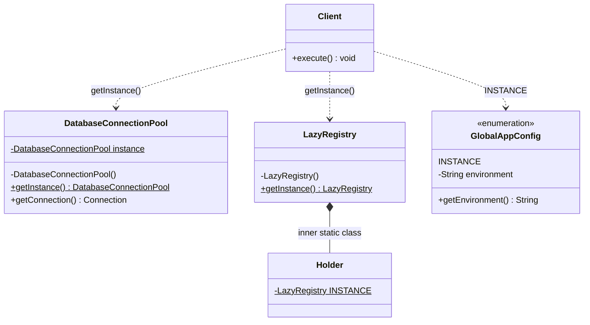
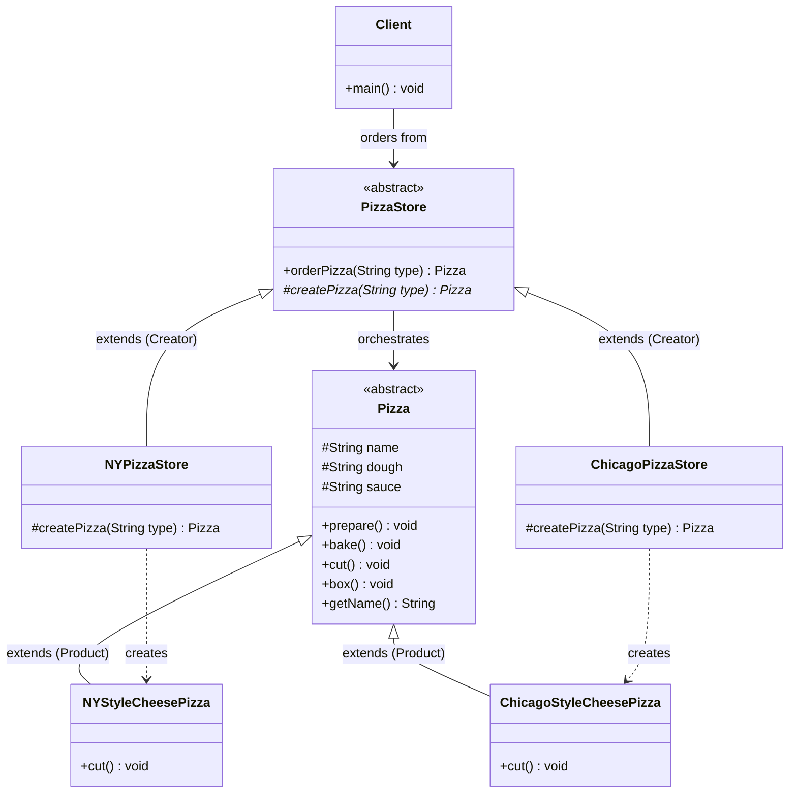
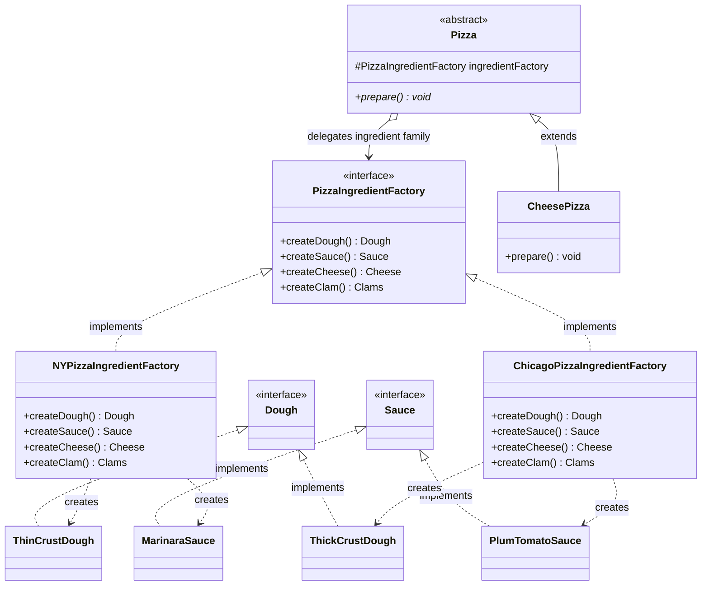
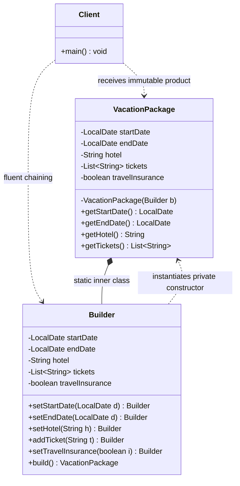
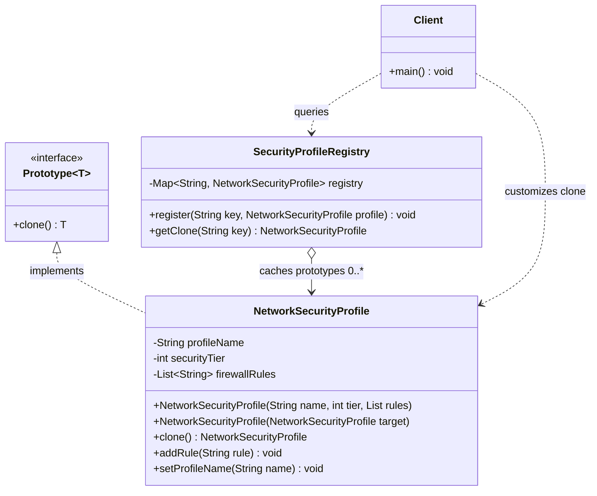

# Part 1: Introduction to Design Patterns

> "Design patterns are typical solutions to commonly occurring problems in software design." — (Gang of Four)

---

- **What a Pattern Is (and Isn't):**
    - It is **not** a piece of code you copy-paste into an IDE.
    - It is a customizable architectural blueprint or high-level concept tailored to solve a recurrent recurring design challenge.
        
- **Why Use Design Patterns?**
    - **Shared Vocabulary:** Communicating "We use an Abstract Factory here" instantly conveys intent, boundaries, and structure to team members without explaining every method.
    - **Proven Architectures:** Built upon battle-tested OOP design principles (SOLID) to prevent code regression, high coupling, and rigid architectures.
---
- **Classification of Patterns:**
    - **Creational:** Deal with object creation mechanisms, isolating instantiation logic from usage.
    - **Structural:** Deal with object composition, assembling classes and objects into larger, flexible structures.
    - **Behavioral:** Deal with algorithms and the assignment of responsibilities between collaborating objects.
        
- **Creational Patterns Core Goal:**
    - Decouple the client code from the concrete classes it needs to instantiate, enforcing the Single Responsibility Principle (SRP) and Open/Closed Principle (OCP).
    
---  

# Part 2: Singleton Pattern
### Intent & Mechanics
Ensures that a class has **only one instance** and provides a **global point of access** to that instance.
- **Typical Use Cases:** Shared resources like database connection pools, hardware drivers, or configuration caches.
- **Implementation Essentials:**
    1. Private constructor (prevents direct instantiation via `new`).
    2. Private `static` instance holding the single created object.
    3. Public `static` accessor method (`getInstance()`) returning that instance.

---

### Pattern Architecture

#### Class Diagram: Singleton Idioms & Lifecycle Structure



---
### Evolution of Java Singletons
#### 1. Lazy Initialization (Thread-Unsafe — Bad)

```java
public class UnsafeSingleton {
    private static UnsafeSingleton instance;
    private UnsafeSingleton() {}

    public static UnsafeSingleton getInstance() {
        if (instance == null) {
            instance = new UnsafeSingleton(); // Race condition if multiple threads enter simultaneously
        }
        return instance;
    }
}
```

---
#### 2. Thread-Safe Double-Checked Locking (Classic Production Approach)

```java
public class DatabaseConnectionPool {
    // volatile prevents instruction reordering hazards during initialization
    private static volatile DatabaseConnectionPool instance;
    
    private DatabaseConnectionPool() {
        // Guard against reflection attack instantiation
        if (instance != null) {
            throw new IllegalStateException("Already initialized");
        }
    }

    public static DatabaseConnectionPool getInstance() {
        if (instance == null) {
            synchronized (DatabaseConnectionPool.class) {
                if (instance == null) {
                    instance = new DatabaseConnectionPool();
                }
            }
        }
        return instance;
    }
}
```

---
#### 3. Initialization-on-Demand Holder Idiom (Clean & Lazy)
JVM classloader guarantees thread-safety and lazy loading without explicit `synchronized` blocks.

```java
public class LazyRegistry {
    private LazyRegistry() {}

    private static class Holder {
        private static final LazyRegistry INSTANCE = new LazyRegistry();
    }

    public static LazyRegistry getInstance() {
        return Holder.INSTANCE;
    }
}
```
---
#### 4. Enum Singleton (Effective Java Recommendation)

Immune to reflection attacks and serialization pitfalls.

```java
public enum GlobalAppConfig {
    INSTANCE;
    
    private String environment = "PRODUCTION";

    public String getEnvironment() {
        return environment;
    }
}
```
---
### The Dark Side: Why Singletons Are Often Treated as Anti-Patterns
- **Hidden Dependencies:** Call sites conceal what classes depend on; dependencies are fetched globally rather than declared in constructors.
- **Unit Testing Nightmare:** Retains global state across test runs, breaking test isolation and preventing easy mocking.
- **SRP Violation:** The class controls its business responsibility _and_ strictly manages its own global lifecycle.
    
---
# Part 3: Factory Method Pattern

## 1. The Problem: The Peril of `new` and Concrete Coupling

* In object-oriented programming, whenever we use the `new` operator, we instantiate a concrete class, which binds our code to an implementation rather than an interface.
* When business requirements change, code that directly instantiates concrete types must be reopened and modified, violating the principle of keeping designs **closed for modification**.
---
### The Naive `orderPizza()` Approach
In an initial pizza store implementation, instantiation is hardcoded directly inside the order method:

```java
public class PizzaStore {
    public Pizza orderPizza(String type) {
        Pizza pizza;

        // Code that VARIES as menu items change:
        if (type.equals("cheese")) {
            pizza = new CheesePizza();
        } else if (type.equals("pepperoni")) {
            pizza = new PepperoniPizza();
        } else if (type.equals("clam")) {
            pizza = new ClamPizza();
        } else if (type.equals("veggie")) {
            pizza = new VeggiePizza();
        } else {
            return null;
        }

        // Code that STAYS THE SAME across all pizzas:
        pizza.prepare();
        pizza.bake();
        pizza.cut();
        pizza.box();

        return pizza;
    }
}
````

---
- **Core Smells & Violations:**
    - **Not Closed for Modification:** Adding a new pizza type or removing an existing one forces modifications to `orderPizza()`.
    - **Violates Single Responsibility Principle:** The method is responsible for both orchestrating pizza processing and constructing concrete pizza instances.

## 2. Warm-Up: Simple Factory (Programming Idiom)
- To clean up the method, we apply the design principle: **Identify the aspects of your application that vary and separate them from what stays the same**.
- Moving instantiation logic into a standalone factory object encapsulates object creation:

---

```java
public class SimplePizzaFactory {
    public Pizza createPizza(String type) {
        Pizza pizza = null;

        if (type.equals("cheese")) {
            pizza = new CheesePizza();
        } else if (type.equals("pepperoni")) {
            pizza = new PepperoniPizza();
        } else if (type.equals("clam")) {
            pizza = new ClamPizza();
        } else if (type.equals("veggie")) {
            pizza = new VeggiePizza();
        }
        return pizza;
    }
}
```

---

The client (`PizzaStore`) delegates creation to the factory:

```java
public class PizzaStore {
    private final SimplePizzaFactory factory;

    public PizzaStore(SimplePizzaFactory factory) {
        this.factory = factory;
    }

    public Pizza orderPizza(String type) {
        Pizza pizza = factory.createPizza(type);

        pizza.prepare();
        pizza.bake();
        pizza.cut();
        pizza.box();

        return pizza;
    }
}
```

---
> **Note:** Simple Factory is an **idiom**, not a formal Gang of Four (GoF) design pattern. While it encapsulates object creation in a single place, it does not provide the architectural flexibility to vary the creation framework across regional franchises.

---

## 3. The Need for Factory Method: Franchising & Regional Variation

- When franchising `PizzaStore` to multiple regions (such as New York and Chicago), each location requires different pizza styles (e.g., thin crust and marinara vs. deep dish and plum tomato sauce).
    
- Composing separate simple factories (`NYPizzaFactory`, `ChicagoPizzaFactory`) causes franchises to deviate from the standard operational workflow (e.g., changing baking times, using custom boxes, or omitting cutting steps).
    
- **Goal:** Create a framework that binds the standard preparation procedure in `PizzaStore` while giving regional subclasses complete control over how pizzas are made.

---
## 4. The Framework: Putting the Factory Method in `PizzaStore`
- In the Factory Method Pattern, `createPizza()` is moved back into `PizzaStore` as an **abstract method**.
- The high-level workflow (`orderPizza()`) remains intact in the abstract base class and relies on the factory method to obtain a `Pizza` without knowing which concrete class is instantiated.

```java
public abstract class PizzaStore {

    // High-level policy orchestrates the lifecycle
    public Pizza orderPizza(String type) {
        Pizza pizza = createPizza(type);

        pizza.prepare();
        pizza.bake();
        pizza.cut();
        pizza.box();

        return pizza;
    }

    // The Factory Method: deferred to subclasses
    protected abstract Pizza createPizza(String type);
}
```

---
### Pattern Architecture

#### Class Diagram: Parallel Creator & Product Hierarchies



---
### The Concrete Products

```java
public abstract class Pizza {
    String name;
    String dough;
    String sauce;
    List<String> toppings = new ArrayList<>();

    void prepare() {
        System.out.println("Preparing " + name);
        System.out.println("Tossing dough...");
        System.out.println("Adding sauce...");
        System.out.println("Adding toppings: ");
        for (String topping : toppings) {
            System.out.println("   " + topping);
        }
    }

    void bake() {
        System.out.println("Bake for 25 minutes at 350");
    }

    void cut() {
        System.out.println("Cutting the pizza into diagonal slices");
    }

    void box() {
        System.out.println("Place pizza in official PizzaStore box");
    }

    public String getName() {
        return name;
    }
}
```
---
```java
public class NYStyleCheesePizza extends Pizza {
    public NYStyleCheesePizza() {
        name = "NY Style Sauce and Cheese Pizza";
        dough = "Thin Crust Dough";
        sauce = "Marinara Sauce";
        toppings.add("Grated Reggiano Cheese");
    }
}

public class ChicagoStyleCheesePizza extends Pizza {
    public ChicagoStyleCheesePizza() {
        name = "Chicago Style Deep Dish Cheese Pizza";
        dough = "Extra Thick Crust Dough";
        sauce = "Plum Tomato Sauce";
        toppings.add("Shredded Mozzarella Cheese");
    }

    @Override
    void cut() {
        System.out.println("Cutting the pizza into square slices");
    }
}
```

---

### The Concrete Creators

```java
public class NYPizzaStore extends PizzaStore {
    @Override
    protected Pizza createPizza(String item) {
        if (item.equals("cheese")) {
            return new NYStyleCheesePizza();
        } else if (item.equals("veggie")) {
            return new NYStyleVeggiePizza();
        } else if (item.equals("clam")) {
            return new NYStyleClamPizza();
        } else if (item.equals("pepperoni")) {
            return new NYStylePepperoniPizza();
        }
        return null;
    }
}

public class ChicagoPizzaStore extends PizzaStore {
    @Override
    protected Pizza createPizza(String item) {
        if (item.equals("cheese")) {
            return new ChicagoStyleCheesePizza();
        } else if (item.equals("veggie")) {
            return new ChicagoStyleVeggiePizza();
        } else if (item.equals("clam")) {
            return new ChicagoStyleClamPizza();
        } else if (item.equals("pepperoni")) {
            return new ChicagoStylePepperoniPizza();
        }
        return null;
    }
}
```
---
```
class ChicagoStyleCheesePizza extends Pizza {  
}  
  
class ChicagoStyleVeggiePizza extends Pizza {  
}  
  
class ChicagoStyleClamPizza extends Pizza {  
}  
  
class ChicagoStylePepperoniPizza extends Pizza {  
}

class NYStyleCheesePizza extends Pizza {  
}  
  
class NYStyleVeggiePizza extends Pizza {  
}  
  
class NYStyleClamPizza extends Pizza {  
}  
  
class NYStylePepperoniPizza extends Pizza {  
}
```

---
## 6. Execution Walkthrough: Behind the Scenes

````java
public abstract class PizzaStore {

    public Pizza orderPizza(String type) {
        Pizza pizza;

        // Delegating object creation to the abstract factory method
        pizza = createPizza(type);

        // Standardized preparation lifecycle that remains consistent across all franchises
        pizza.prepare();
        pizza.bake();
        pizza.cut();
        pizza.box();

        return pizza;
    }

    // The Factory Method: each regional store must implement its own creation logic
    protected abstract Pizza createPizza(String type);
}
````
---
```java
public class PizzaTestDrive {
    public static void main(String[] args) {
        PizzaStore nyStore = new NYPizzaStore();
        PizzaStore chicagoStore = new ChicagoPizzaStore();

        Pizza pizza = nyStore.orderPizza("cheese");
        System.out.println("Ethan ordered a " + pizza.getName() + "\n");

        pizza = chicagoStore.orderPizza("cheese");
        System.out.println("Joel ordered a " + pizza.getName() + "\n");
    }
}
```

---
1. **Store Instantiation:** The client chooses an operating context by creating a `NYPizzaStore` or `ChicagoPizzaStore`.
2. **Order Invocation:** The client calls `orderPizza("cheese")` on the instance.
3. **Delegation to Factory Method:** The template method `orderPizza()` runs its algorithm and triggers `createPizza("cheese")`.
4. **Concrete Instantiation:** The regional subclass executes its specific `createPizza()` method, instantiating the concrete product (`NYStyleCheesePizza` or `ChicagoStyleCheesePizza`).
5. **Decoupled Lifecycle Processing:** `orderPizza()` receives the abstract `Pizza` reference and carries out `prepare()`, `bake()`, `cut()`, and `box()` polymorphically.
---
## 7. Formal Definition

> **The Factory Method Pattern** defines an interface for creating an object, but lets subclasses decide which class to instantiate. Factory Method lets a class defer instantiation to subclasses.

---
# Part 4: Abstract Factory Pattern

## 1. The Problem: Ingredient Quality Control

* In the Factory Method approach, each regional franchise (`NYPizzaStore`, `ChicagoPizzaStore`) was given complete freedom to instantiate its own concrete pizzas.
* **The New Operational Problem:** Some franchises cut corners to save costs by using inferior, generic ingredients—substituting cheap cheese for authentic Reggiano or low-grade sauce for plum tomatoes.
* **The Goal:** Build a centralized framework that guarantees quality control across all franchises by shipping consistent, regionally authentic **families of ingredients** (`Dough`, `Sauce`, `Cheese`, `Veggies`, `Clams`).

---

## 2. Defining the Product Families (Ingredients)
Instead of a single product hierarchy (`Pizza`), we now manage multiple distinct product interfaces representing the constituent parts of a pizza:

```java
// Ingredient Interfaces
public interface Dough {}
public interface Sauce {}
public interface Cheese {}
public interface Veggies {}
public interface Pepperoni {}
public interface Clams {}
````

---
### Regional Concrete Ingredient Implementations
Each region has its own coherent family of ingredients:

```java
// New York Family
public class ThinCrustDough implements Dough {}
public class MarinaraSauce implements Sauce {}
public class ReggianoCheese implements Cheese {}
public class Garlic implements Veggies {}
public class FreshClams implements Clams {}

// Chicago Family
public class ThickCrustDough implements Dough {}
public class PlumTomatoSauce implements Sauce {}
public class MozzarellaCheese implements Cheese {}
public class BlackOlives implements Veggies {}
public class FrozenClams implements Clams {}
```

---
## 3. The Abstract Factory Interface
The **Abstract Factory** defines an interface with factory methods for creating each member of the product family:

```java
public interface PizzaIngredientFactory {
    Dough createDough();
    Sauce createSauce();
    Cheese createCheese();
    Veggies[] createVeggies();
    Pepperoni createPepperoni();
    Clams createClams();
}
```

---
### Concrete Ingredient Factories
Each concrete factory is responsible for producing the entire family of ingredients for its respective region:

```java
public class NYPizzaIngredientFactory implements PizzaIngredientFactory {
    @Override
    public Dough createDough() {
        return new ThinCrustDough();
    }

    @Override
    public Sauce createSauce() {
        return new MarinaraSauce();
    }

    @Override
    public Cheese createCheese() {
        return new ReggianoCheese();
    }

    @Override
    public Veggies[] createVeggies() {
        return new Veggies[]{ new Garlic(), new Onion(), new Mushroom(), new RedPepper() };
    }

    @Override
    public Pepperoni createPepperoni() {
        return new SlicedPepperoni();
    }

    @Override
    public Clams createClams() {
        return new FreshClams();
    }
}
```
---
```java
public class ChicagoPizzaIngredientFactory implements PizzaIngredientFactory {
    @Override
    public Dough createDough() {
        return new ThickCrustDough();
    }

    @Override
    public Sauce createSauce() {
        return new PlumTomatoSauce();
    }

    @Override
    public Cheese createCheese() {
        return new MozzarellaCheese();
    }

    @Override
    public Veggies[] createVeggies() {
        return new Veggies[]{ new BlackOlives(), new Spinach(), new Eggplant() };
    }

    @Override
    public Pepperoni createPepperoni() {
        return new SlicedPepperoni();
    }

    @Override
    public Clams createClams() {
        return new FrozenClams();
    }
}
```

---
## 4. Refactoring `Pizza`: Relying on the Factory via Composition
- In Factory Method, `Pizza` subclasses like `NYStyleCheesePizza` hardcoded their ingredients in their constructors.
- With Abstract Factory, `Pizza` becomes independent of the region. A `CheesePizza` or `ClamPizza` gets its ingredients composed directly from whatever `PizzaIngredientFactory` is passed in:

---
```java
public abstract class Pizza {
    String name;
    Dough dough;
    Sauce sauce;
    Veggies[] veggies;
    Cheese cheese;
    Pepperoni pepperoni;
    Clams clams;

    // Abstract prepare method: subclasses collect ingredients from their factory
    public abstract void prepare();

    public void bake() {
        System.out.println("Bake for 25 minutes at 350");
    }

    public void cut() {
        System.out.println("Cutting the pizza into diagonal slices");
    }

    public void box() {
        System.out.println("Place pizza in official PizzaStore box");
    }

    public void setName(String name) {
        this.name = name;
    }

    public String getName() {
        return name;
    }
}
```

---
### Concrete Pizza Implementations
The pizza no longer cares which region's ingredients it is using; it only knows how to ask the factory interface to supply them:

```java
public class CheesePizza extends Pizza {
    private final PizzaIngredientFactory ingredientFactory;

    public CheesePizza(PizzaIngredientFactory ingredientFactory) {
        this.ingredientFactory = ingredientFactory;
    }

    @Override
    public void prepare() {
        System.out.println("Preparing " + name);
        dough = ingredientFactory.createDough();
        sauce = ingredientFactory.createSauce();
        cheese = ingredientFactory.createCheese();
    }
}
```

---

```java
public class ClamPizza extends Pizza {
    private final PizzaIngredientFactory ingredientFactory;

    public ClamPizza(PizzaIngredientFactory ingredientFactory) {
        this.ingredientFactory = ingredientFactory;
    }

    @Override
    public void prepare() {
        System.out.println("Preparing " + name);
        dough = ingredientFactory.createDough();
        sauce = ingredientFactory.createSauce();
        cheese = ingredientFactory.createCheese();
        clams = ingredientFactory.createClams();
    }
}
```

---
## 5. Integrating the Ingredient Factory into the Regional `PizzaStore`
The regional store creates the pizza using its local ingredient factory:

```java
public class NYPizzaStore extends PizzaStore {

    @Override
    protected Pizza createPizza(String item) {
        Pizza pizza = null;
        // Inject the region-specific ingredient factory
        PizzaIngredientFactory ingredientFactory = new NYPizzaIngredientFactory();

        if (item.equals("cheese")) {
            pizza = new CheesePizza(ingredientFactory);
            pizza.setName("New York Style Cheese Pizza");
        } else if (item.equals("clam")) {
            pizza = new ClamPizza(ingredientFactory);
            pizza.setName("New York Style Clam Pizza");
        }
        return pizza;
    }
}
```
---
## 6. Execution Trace: Behind the Scenes

```
1. Client calls nyStore.orderPizza("cheese")
2. orderPizza() triggers createPizza("cheese") on NYPizzaStore
3. NYPizzaStore initializes NYPizzaIngredientFactory
4. NYPizzaStore instantiates new CheesePizza(ingredientFactory)
5. orderPizza() calls pizza.prepare()
6. CheesePizza asks factory for dough, sauce, and cheese:
      -> factory.createDough()  ==> ThinCrustDough
      -> factory.createSauce()  ==> MarinaraSauce
      -> factory.createCheese() ==> ReggianoCheese
7. orderPizza() runs bake(), cut(), and box()
```
---
## 7. Formal Definition & Structure

> **The Abstract Factory Pattern** provides an interface for creating families of related or dependent objects without specifying their concrete classes.

### Pattern Architecture

#### Class Diagram: Coordinated Product Families Hierarchy



---
## 8. Factory Method vs. Abstract Factory

| **Dimension**           | **Factory Method PDF**                                                               | **Abstract Factory PDF**                                                                            |
| ----------------------- | ------------------------------------------------------------------------------------ | --------------------------------------------------------------------------------------------------- |
| **Primary Mechanism**   | **Inheritance** (creator class relies on subclasses to implement the factory method) | **Object Composition** (creator holds a reference to a factory object and delegates creation to it) |
| **Scope**               | Produces **one** product per method                                                  | Produces an entire **family** of related products                                                   |
| **Adding New Products** | Subclass the creator and provide a new implementation                                | Requires changing the factory interface and updating every concrete factory class[cite: 2]          |
| **Coupling**            | Decouples code via abstract base classes and inheritance                             | Decouples code via interface composition and dependency injection                                   |

---
# Part 5:  Builder Pattern

## 1. Intent & Purpose

* **Definition:** Separates the construction of a complex object from its representation, allowing the exact same construction process to create different representations step by step.
* **Core Problem Solved:** Eliminates the classic **Telescoping Constructor anti-pattern** and provides encapsulation over complex, multi-stage object creation without leaving objects in an inconsistent, half-initialized state.

---

## 2. The Problems with Traditional Instantiation

### A. The Telescoping Constructor Anti-Pattern
When an entity has multiple mandatory and optional attributes, developers often write overloaded constructors for every possible permutation:

```java
public class VacationPlanner {
    public VacationPlanner(LocalDate start, LocalDate end) { ... }
    public VacationPlanner(LocalDate start, LocalDate end, Hotel hotel) { ... }
    public VacationPlanner(LocalDate start, LocalDate end, Hotel hotel, List<Reservation> dinners) { ... }
    public VacationPlanner(LocalDate start, LocalDate end, Hotel hotel, List<Reservation> dinners, List<SpecialEvent> events) { ... }
}
````

- **Pitfalls:**
    - Passing numerous parameters of identical types (`String`, `int`, `boolean`) leads to severe positional errors at the call site.
    - Adding a single new configuration parameter forces updates across all overloaded signatures.
---
### B. The JavaBeans (No-Arg + Setter) Anti-Pattern
Creating an empty object and invoking setters sequentially:

```java
VacationPlanner planner = new VacationPlanner();
planner.setStartDate(start);
planner.setEndDate(end);
// planner is temporarily in an invalid state if an exception occurs here
planner.setHotel(hotel);
```
- **Pitfalls:**
    - **Mutability:** Fields cannot be marked `final`, preventing domain immutability.
    - **Inconsistent State:** The object is exposed to other threads or callers before all required invariants are validated.
---
## 3. Pattern Architecture

### Class Diagram: Director, Builder & Product Structure



---
## 4. Implementation: Vacation Package Builder

In enterprise Java and backend systems, the Builder is commonly implemented as a static inner class of the product being constructed:

```java
public class VacationPackage {

    // Immutable fields
    private final LocalDate startDate;
    private final LocalDate endDate;
    private final String hotel;
    private final List<String> tickets;
    private final boolean travelInsurance;

    // Private constructor: construction is permitted ONLY via the Builder
    private VacationPackage(Builder builder) {
        this.startDate = builder.startDate;
        this.endDate = builder.endDate;
        this.hotel = builder.hotel;
        this.tickets = Collections.unmodifiableList(new ArrayList<>(builder.tickets));
        this.travelInsurance = builder.travelInsurance;
    }

    public LocalDate getStartDate() { return startDate; }
    public LocalDate getEndDate() { return endDate; }
    public String getHotel() { return hotel; }
    public List<String> getTickets() { return tickets; }
    public boolean hasTravelInsurance() { return travelInsurance; }
```
---
```java
    // Static Builder Class
    public static class Builder {
        // Mandatory fields
        private final LocalDate startDate;
        private final LocalDate endDate;

        // Optional fields initialized with default values
        private String hotel = "Standard Room";
        private List<String> tickets = new ArrayList<>();
        private boolean travelInsurance = false;

        public Builder(LocalDate startDate, LocalDate endDate) {
            if (startDate == null || endDate == null || startDate.isAfter(endDate)) {
                throw new IllegalArgumentException("Valid vacation dates are required");
            }
            this.startDate = startDate;
            this.endDate = endDate;
        }

        public Builder hotel(String hotel) {
            this.hotel = hotel;
            return this;
        }

        public Builder addTicket(String eventTicket) {
            this.tickets.add(eventTicket);
            return this;
        }

        public Builder travelInsurance(boolean travelInsurance) {
            this.travelInsurance = travelInsurance;
            return this;
        }

        // Terminal build step: validates cross-field consistency and constructs the immutable product
        public VacationPackage build() {
            if (travelInsurance && tickets.isEmpty()) {
                // Example cross-field invariant check
            }
            return new VacationPackage(this);
        }
    }
}
```

---

## 4. Usage at the Call Site

```java
VacationPackage packageDeal = new VacationPackage.Builder(
        LocalDate.of(2026, 10, 1),
        LocalDate.of(2026, 10, 7)
    )
    .hotel("Grand Resort & Spa")
    .addTicket("Museum Pass")
    .addTicket("Theme Park Admission")
    .travelInsurance(true)
    .build();
```
- **Readability:** Method chaining provides fluent, self-describing configuration.
- **Safety:** Invariants are asserted before the object instance escapes the `build()` method.
- **Thread Safety:** The resulting `VacationPackage` instance contains strictly `final` fields and immutable collections.
---
## 5. Builder vs. Abstract Factory

| **Feature**        | **Builder Pattern**                                                     | **Abstract Factory Pattern**                                                      |
| ------------------ | ----------------------------------------------------------------------- | --------------------------------------------------------------------------------- |
| **Focus**          | Step-by-step assembly of a single complex object.                       | Creation of entire families of related/dependent products.                        |
| **Invocation**     | Multi-step fluent chain ending with a terminal `.build()`.              | Single-method invocation returning a complete product immediately.                |
| **Client Control** | Fine-grained configuration of internal details and optional components. | Client receives standard implementations without picking fine-grained components. |

---
# Part 6:  Prototype Pattern

## 1. Intent & Purpose

* **Formal Definition:** Specify the kinds of objects to create using a prototypical instance, and create new objects by copying or cloning this prototype.
* **Core Problem Solved:** Creates duplicate instances without coupling code to concrete classes, and avoids the costly re-initialization of computationally expensive or I/O-heavy objects.

---

## 2. When to Use the Prototype Pattern

* **Heavy Instantiation Costs:** When creating an object from scratch requires database lookups, disk I/O, heavy computation, or remote API calls, but subsequent instances only need slight adjustments.
* **Complex Object Graphs:** When you need a copy of an existing object with complex internal state without having to reverse-engineer and invoke 15 different setters manually.
* **Decoupling from Concrete Classes:** When client code needs copies of objects whose concrete types are known only at runtime through an interface or superclass.

---

## 3. The Shallow Copy vs. Deep Copy Hazard
Understanding how references are handled in memory is critical when implementing prototypes in Java:

```text
Shallow Copy:
Original: [ Field A: 10 ]  [ Field B: (Reference) ] ───┐
                                                       ├───> [ Shared Mutable List ]
Clone:    [ Field A: 10 ]  [ Field B: (Reference) ] ───┘
(Mutating the list in Clone silently mutates the original!)

Deep Copy:
Original: [ Field A: 10 ]  [ Field B: (Reference) ] ───────> [ Original List ]
Clone:    [ Field A: 10 ]  [ Field B: (Reference) ] ───────> [ Copied Distinct List ]
(Clone completely isolates its own internal state)
````

- **Shallow Copy:** Copies primitive data values directly, but copies object references as-is. Both the original and clone reference the same nested objects. Modifying nested mutable objects corrupts both instances.
- **Deep Copy:** Recursively clones the entire object graph, allocating distinct heap memory for all inner objects and collections.
---
## 4. Pattern Architecture

### Class Diagram: Prototype Contract & Registry Structure



---
### B. Standard Approach: Explicit Prototype Interface with Deep Copy
Define an explicit domain contract that enforces typed cloning:

```java
public interface Prototype<T> {
    T clone();
}
```
---
#### Concrete Implementation (Network Infrastructure Profile Example)

```java
public class NetworkSecurityProfile implements Prototype<NetworkSecurityProfile> {

    private String profileName;
    private int maxBandwidthMbps;
    private List<String> firewallRules;

    public NetworkSecurityProfile(String profileName, int maxBandwidthMbps, List<String> firewallRules) {
        this.profileName = profileName;
        this.maxBandwidthMbps = maxBandwidthMbps;
        this.firewallRules = firewallRules;
    }

    // Deep Copy Constructor
    public NetworkSecurityProfile(NetworkSecurityProfile target) {
        if (target != null) {
            this.profileName = target.profileName;
            this.maxBandwidthMbps = target.maxBandwidthMbps;
            // Create a completely new list to isolate references (Deep Copy)
            this.firewallRules = new ArrayList<>(target.firewallRules);
        }
    }
```
---
```java
    @Override
    public NetworkSecurityProfile clone() {
        return new NetworkSecurityProfile(this);
    }

    public void addRule(String rule) {
        this.firewallRules.add(rule);
    }

    public void setProfileName(String profileName) {
        this.profileName = profileName;
    }

    public List<String> getFirewallRules() {
        return Collections.unmodifiableList(firewallRules);
    }
}
```
---
## 5. Prototype Registry / Cache Management
In backend services, Prototypes are frequently coordinated through a central **Prototype Registry** or cache to serve pre-configured objects on demand:

```java
public class SecurityProfileRegistry {

    private final Map<String, NetworkSecurityProfile> registry = new HashMap<>();

    public void register(String key, NetworkSecurityProfile profile) {
        registry.put(key, profile);
    }

    public NetworkSecurityProfile getClone(String key) {
        NetworkSecurityProfile prototype = registry.get(key);
        if (prototype == null) {
            throw new IllegalArgumentException("No prototype registered for key: " + key);
        }
        return prototype.clone();
    }
}
```
#### Client Invocation Site

```java
// Setup default prototypes once during application bootstrap
SecurityProfileRegistry registry = new SecurityProfileRegistry();
registry.register("STANDARD_APP", new NetworkSecurityProfile("STANDARD_APP", 100, List.of("PORT_80", "PORT_443")));

// Client requests a pre-warmed clone and customizes it without affecting the cached original
NetworkSecurityProfile tenantProfile = registry.getClone("STANDARD_APP");
tenantProfile.setProfileName("TENANT_CORP_A");
tenantProfile.addRule("PORT_8080");
```

--- 
# Part 7: Daily Extra: Language & Framework Evolution — The Demise of Creational Boilerplate

---
## 1. Why Creational Patterns Exist (The "Missing Language Features" Thesis)

Many classic Gang of Four (GoF) creational patterns were originally invented in the mid-1990s as design-level workarounds for limitations in early object-oriented languages (like C++ and early Java).

* **The Core Problem:** Languages historically only provided raw constructor invocation (`new MyClass()`), with:
  * No named arguments.
  * No default parameter values.
  * No declarative lifecycle or dependency management.
  * Verbose, unsafe object-cloning semantics.
* **The Evolution:** Modern backend runtimes solve these challenges at two distinct levels:
  1. **Framework-Level Automation:** Spring Boot's Inversion of Control (IoC) container manages lifecycles, scopes, and factory instantiations declaratively.
  2. **Language-Level Ergonomics:** Modern JVM languages like Kotlin provide first-class compiler features that render many creational patterns obsolete for day-to-day business code.

---

## 2. Inversion of Control (IoC): The Universal Enterprise Factory
In a modern Spring Boot backend, developers rarely write manual Singletons, Factory Methods, or Abstract Factories. The **Spring IoC Container** functions as the application's global creational orchestrator.

---
### A. Replacing the Singleton Anti-Pattern with Managed Bean Lifecycles
* **Classic Singleton Hazard:** Tight coupling through static access (`MyClass.getInstance()`), memory leak hazards, multithreading race conditions, and poor test mockability.
* **The Framework Approach:** Classes are written as clean, unadorned POJOs/components. Spring ensures a single instance exists across the `ApplicationContext`:

```java
@Service // Managed by Spring as a container-wide singleton by default
public class PaymentProcessingService {

    private final PaymentGatewayClient gatewayClient;

    // Injected automatically via constructor dependency injection
    public PaymentProcessingService(PaymentGatewayClient gatewayClient) {
        this.gatewayClient = gatewayClient;
    }
}
````

---
### B. Declarative Factories via `@Configuration` & `@Bean`
Instead of writing complex abstract factory hierarchies, Spring uses declarative factory methods:

```java
@Configuration
public class CloudInfrastructureConfig {

    // Spring acts as the factory method: resolving configuration,
    // handling instantiation, and registering the returned instance in the container.
    @Bean
    @Profile("aws")
    public StorageClient awsStorageClient(@Value("${aws.bucket}") String bucket) {
        return new S3StorageClient(bucket);
    }

    @Bean
    @Profile("azure")
    public StorageClient azureStorageClient(@Value("${azure.container}") String container) {
        return new AzureBlobStorageClient(container);
    }
}
```

---
### C. Container-Managed Scopes: Singleton vs. Prototype
Instead of maintaining custom prototype registries or cloning engines:

```java
@Component
@Scope(ConfigurableBeanFactory.SCOPE_PROTOTYPE) // Generates a fresh instance whenever requested
public class HeavyReportTask {
    // Isolated task state
}
```

---
## 3. Language Evolution: How Modern Kotlin Eliminates Creational Boilerplate

Modern backend Kotlin replaces dozens of lines of Java creational plumbing with concise language keywords.

---
### A. Singleton $\rightarrow$ Kotlin `object`

No private constructors, double-checked locks, or volatile variables needed. The Kotlin runtime guarantees thread-safe, classloader-level lazy initialization natively.

**Classic Java Double-Checked Lock (~25 lines):**

```java
public class CacheRegistry {
    private static volatile CacheRegistry instance;
    private CacheRegistry() {}

    public static CacheRegistry getInstance() {
        if (instance == null) {
            synchronized (CacheRegistry.class) {
                if (instance == null) {
                    instance = new CacheRegistry();
                }
            }
        }
        return instance;
    }
}
```

**Kotlin Equivalent (1 line):**

```Kotlin
object CacheRegistry {
    fun fetch(key: String): Any? = null
}
```
---
### B. Builder $\rightarrow$ Named Arguments & Default Parameter Values

The Builder Pattern primarily exists in Java to avoid telescoping constructors and long, ambiguous argument lists. Kotlin renders manual Builders unnecessary for domain models.

**Classic Java Builder (~40 lines):**

```Java
// Requires DatabaseConfig class, private constructor, Builder class,
// fluent setter methods, and terminal build() method.
DatabaseConfig config = new DatabaseConfig.Builder("localhost", "inventory_db")
        .port(5432)
        .sslEnabled(true)
        .maxConnections(50)
        .build();
```

---

**Kotlin Equivalent (Native constructor flexibility):**
```Kotlin
data class DatabaseConfig(
    val host: String,
    val databaseName: String,
    val port: Int = 5432,
    val sslEnabled: Boolean = false,
    val maxConnections: Int = 10
)

// Usage: named arguments provide clear call sites and optional parameter handling
val config = DatabaseConfig(
    host = "localhost",
    databaseName = "inventory_db",
    maxConnections = 50
)
```

---
### C. Prototype $\rightarrow$ Kotlin `.copy()`
Java prototyping requires implementing custom interfaces, deep-copy constructors, or navigating `Cloneable`. Kotlin's `data class` automatically synthesizes an optimized `.copy()` method with named argument overriding.

```Kotlin
data class SecurityProfile(
    val profileName: String,
    val maxBandwidthMbps: Int,
    val firewallRules: List<String>
)

val defaultProfile = SecurityProfile(
    profileName = "DEFAULT_TENANT",
    maxBandwidthMbps = 100,
    firewallRules = listOf("PORT_80", "PORT_443")
)

// Cloning with targeted property mutation (Prototype pattern natively):
val premiumProfile = defaultProfile.copy(
    profileName = "ENTERPRISE_TENANT",
    maxBandwidthMbps = 1000
)
```
---
## 4. Modern Creational Comparison Matrix

|**Creational Problem**|**Classic Java (GoF Pattern)**|**Modern Spring Approach**|**Modern Kotlin Approach**|
|---|---|---|---|
|**Single Shared Instance**|Singleton (Private constructor + `getInstance()`)|Container-managed `@Service` / `@Component`|`object MySingleton`|
|**Object Construction with Defaults**|Builder Pattern|Spring Builder APIs (`RestTemplateBuilder`, etc.)|Named arguments & default values|
|**Conditional Subtype Instantiation**|Factory Method / Abstract Factory|IoC Container + `@Bean` + Profiles / Qualifiers|Top-level factory functions / `sealed class`|
|**Object Duplication with State Mutation**|Prototype Pattern (Clone/Deep copy constructors)|`@Scope("prototype")` beans|Data class `.copy()`|

---
## 5. Architectural Guidance: When Do GoF Patterns Still Matter?

1. **At Cross-System Boundaries:**
    - When integrating complex third-party SDKs that do not run inside the Spring context, classic manual Factories and Builders remain useful.
2. **Framework & Library Engineering:**
    - If you are writing a custom framework, starter library, or plugin architecture for other engineers, GoF creational patterns establish clean extension points.
3. **Understanding Framework Internals:**
    - Recognizing Factory Methods, Builders, and Prototypes enables engineers to configure and troubleshoot Spring Boot, Hibernate, and Netty internals with confidence.