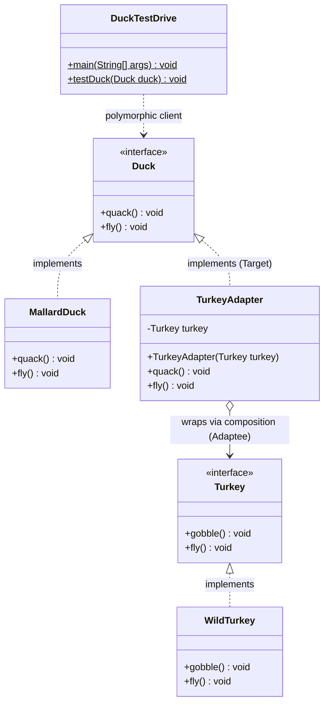
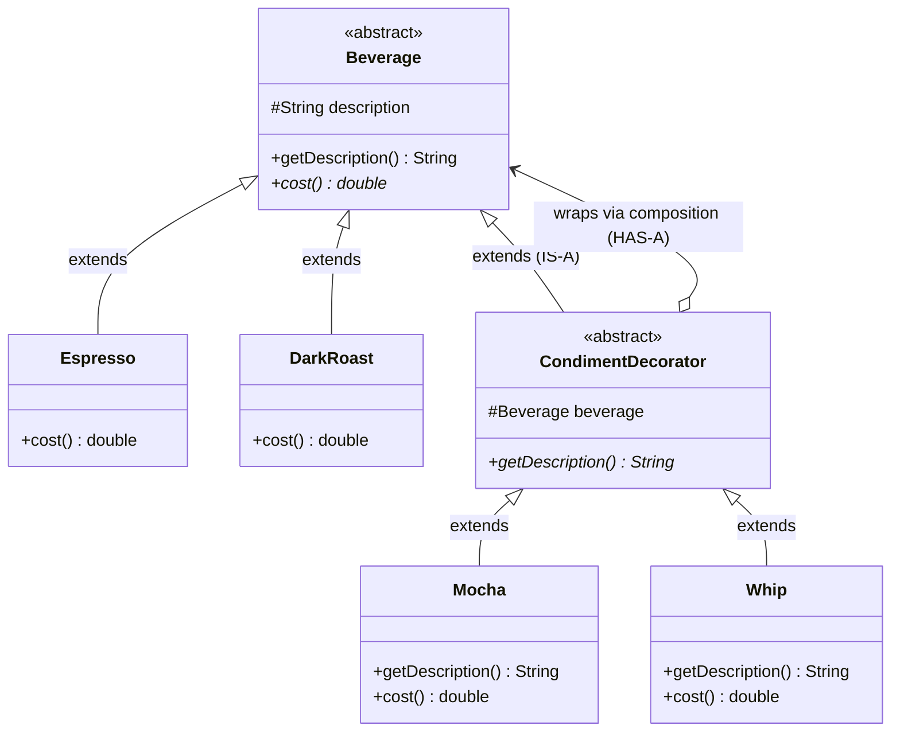
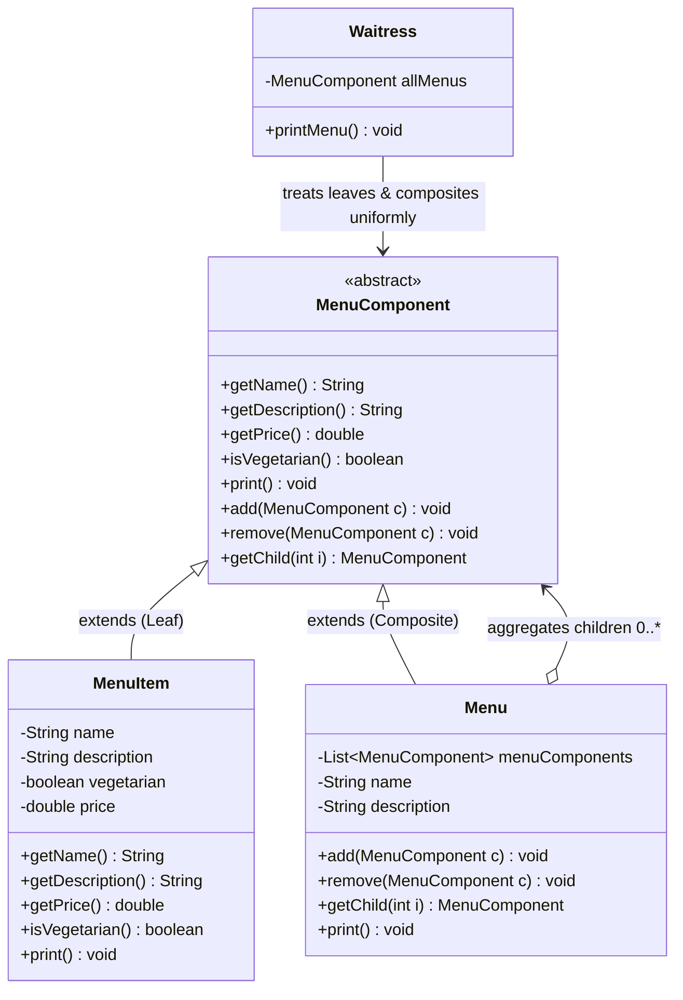
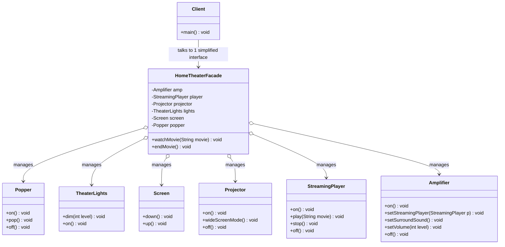
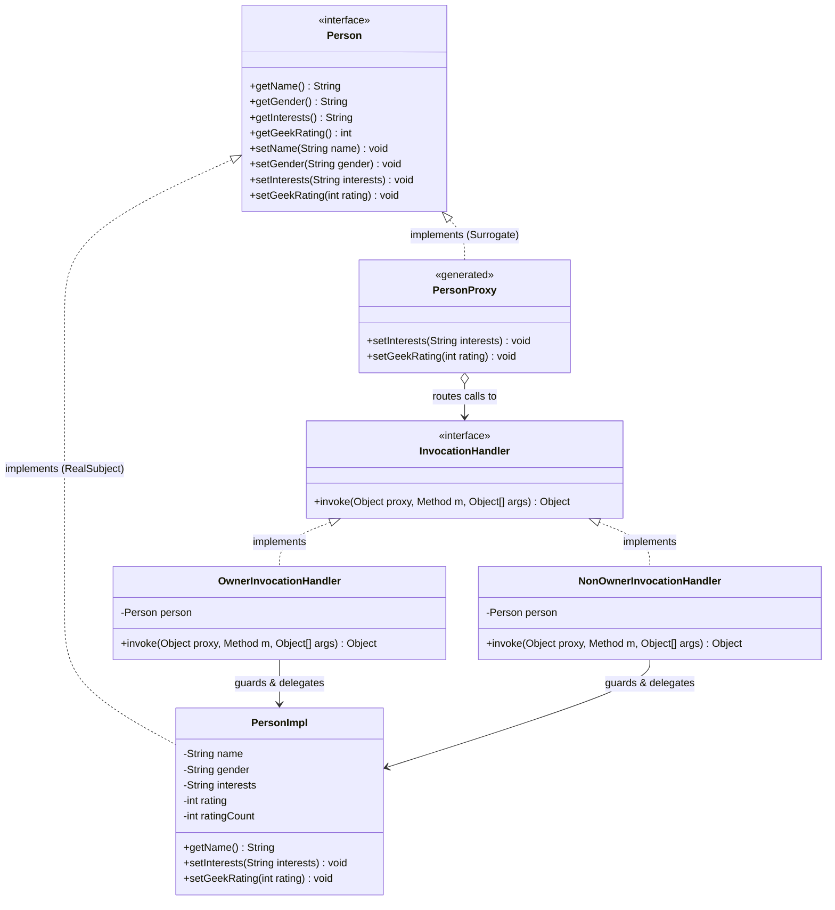

# Adapter Pattern

---

## 1. Intent & Real-World Analogy

* **Formal Definition:** Converts the interface of a class into another interface that clients expect. Adapter lets classes work together that couldn't otherwise because of incompatible interfaces.
* **Real-World Analogy:** A European travel plug adapter. The British/European wall outlet provides power through a specific two- or three-pin socket, but your laptop cord has a standard US plug. You don't rebuild the wall outlet or strip the laptop wires; you place an adapter between them that wraps the incompatible interface and translates the connection.

---

## 2. The Problem: Integrating Third-Party or Legacy Components
Imagine your system is built entirely around an existing `Duck` interface:

```java
public interface Duck {
    void quack();
    void fly();
}
````

You have existing concrete implementations like `MallardDuck` running across client workflows:

```java
public class MallardDuck implements Duck {
    @Override
    public void quack() {
        System.out.println("Quack");
    }

    @Override
    public void fly() {
        System.out.println("I'm flying");
    }
}
```
---
Now, your application needs to incorporate a newly purchased or third-party library that supplies `Turkey` objects:

```java
public interface Turkey {
    void gobble();
    void fly(); // Turkeys fly only short distances
}
```

```java
public class WildTurkey implements Turkey {
    @Override
    public void gobble() {
        System.out.println("Gobble gobble");
    }

    @Override
    public void fly() {
        System.out.println("I'm flying a short distance");
    }
}
```
---
- **The Dilemma:** The client code expects a `Duck` (calls `quack()` and expects full flights). You cannot pass a `WildTurkey` directly to client methods expecting a `Duck` because their interfaces are completely incompatible. Changing existing client code breaks the **Open/Closed Principle**.
---
## 3. The Solution: The Object Adapter

Create an adapter class that implements the target interface (`Duck`) and holds a reference to the adaptee (`Turkey`) via **composition**:

```java
public class TurkeyAdapter implements Duck {
    private final Turkey turkey;

    // The adapter is composed with the adaptee
    public TurkeyAdapter(Turkey turkey) {
        this.turkey = turkey;
    }

    @Override
    public void quack() {
        // Translating the call: quack() becomes gobble()
        turkey.gobble();
    }

    @Override
    public void fly() {
        // Adapting behavior: Turkeys fly in short bursts,
        // so to mimic a duck, fly five times
        for (int i = 0; i < 5; i++) {
            turkey.fly();
        }
    }
}
```

---

## 3.1 Pattern Architecture

### Class Diagram: Target, Adapter & Adaptee Participants



---
## 4. Client Usage & Execution Flow

```java
public class DuckTestDrive {
    public static void main(String[] args) {
        Duck duck = new MallardDuck();
        Turkey turkey = new WildTurkey();
        
        // Wrap the turkey inside a TurkeyAdapter so it looks and acts like a Duck
        Duck turkeyAdapter = new TurkeyAdapter(turkey);

        System.out.println("The Turkey says...");
        turkey.gobble();
        turkey.fly();

        System.out.println("\nThe Duck says...");
        testDuck(duck);

        System.out.println("\nThe TurkeyAdapter says...");
        // Client treats the adapted Turkey exactly like any Duck!
        testDuck(turkeyAdapter);
    }

    static void testDuck(Duck duck) {
        duck.quack();
        duck.fly();
    }
}
```

---

### Execution Output:

```
The Turkey says...
Gobble gobble
I'm flying a short distance

The Duck says...
Quack
I'm flying

The TurkeyAdapter says...
Gobble gobble
I'm flying a short distance
I'm flying a short distance
I'm flying a short distance
I'm flying a short distance
I'm flying a short distance
```

---
## 5. How the Client Interacts with the Adapter

Plaintext

```
[ Client ] 
    │
    │ 1. Calls target interface method: request() / quack()
    ▼
[ Adapter (implements Target) ]
    │
    │ 2. Translates request to adaptee interface: specificRequest() / gobble()
    ▼
[ Adaptee (Turkey) ]
```

1. The client makes a call to the adapter using the target interface method (`quack()`).
2. The adapter translates that invocation into one or more calls on the adaptee using the adaptee interface (`gobble()`).
3. The client receives the expected results transparently, without ever knowing an adaptation layer was involved.
---
## 6. Object Adapter vs. Class Adapter

There are two primary flavors of adapters in the Gang of Four catalog:

| **Dimension**           | **Object Adapter (Recommended)**                                | **Class Adapter**                                                                        |
| ----------------------- | --------------------------------------------------------------- | ---------------------------------------------------------------------------------------- |
| **Mechanism**           | Uses **Composition** (HAS-A relationship).                      | Uses **Multiple Inheritance** (IS-A both Target and Adaptee).                            |
| **Java Compatibility**  | Fully supported in standard Java.                               | **Not possible** in Java for classes (Java does not support multiple class inheritance). |
| **Flexibility**         | Can adapt an adaptee and **any of its subclasses** dynamically. | Binds strictly to one concrete adaptee class at compile time                             |
| **Overriding Behavior** | Cannot easily override adaptee behavior unless subclassed.      | Can directly override parts of the adaptee's behavior since it subclasses it             |

---
## 7. Classic Real-World Example: Adapting `Enumeration` to `Iterator`

In early Java (JDK 1.0/1.1), collections used the `Enumeration` interface (`hasMoreElements()`, `nextElement()`). When Java 2 introduced the Collections Framework with `Iterator` (`hasNext()`, `next()`, `remove()`), legacy APIs returning `Enumeration` needed an adapter to work with modern methods expecting `Iterator:

```java
public class EnumerationIterator implements Iterator<Object> {
    private final Enumeration<?> enumeration;

    public EnumerationIterator(Enumeration<?> enumeration) {
        this.enumeration = enumeration;
    }

    @Override
    public boolean hasNext() {
        return enumeration.hasMoreElements();
    }

    @Override
    public Object next() {
        return enumeration.nextElement();
    }

    @Override
    public void remove() {
        // Enumeration did not support element removal
        throw new UnsupportedOperationException();
    }
}
```

---
## 8. Backend & Spring Ecosystem Application: Ports and Adapters

In modern enterprise architectures (Hexagonal / Clean Architecture):
- **Target Interface (Port):** The domain defines an abstract port (e.g., `PaymentGatewayPort`, `NotificationPort`).
- **Adaptee (Infrastructure SDK):** The third-party payment vendor library (e.g., Stripe SDK, PayPal SDK, Fawry SDK).
- **Adapter:** A concrete Spring `@Component` that implements `PaymentGatewayPort`, wraps the SDK, and translates vendor-specific payloads into clean domain models without letting external API contracts leak into core business logic.

# Decorator Pattern

---
## 1. Intent & Purpose

* **Formal Definition:** Attaches additional responsibilities to an object dynamically. Decorators provide a flexible alternative to subclassing for extending functionality.
* **Core Problem Solved:** Eliminates the **class explosion** caused by relying on static compile-time inheritance to represent every combination of optional behaviors or features.

---
## 2. The Problem: Class Explosion at Starbuzz Coffee

Starbuzz Coffee initially designed its beverage menu around an abstract superclass `Beverage` and subclassed it for every drink:

```text
               Beverage
              /   |   \
     HouseBlend  DarkRoast  Espresso  Decaf
````
---
### The Naive Attempt: Subclassing Every Combination
When condiments were introduced (Steamed Milk, Soy, Mocha, Whip), the design spiraled out of control:
- `HouseBlendWithMocha`
- `HouseBlendWithSoyAndMocha`
- `DarkRoastWithSteamedMilkAndCaramel`
- `EspressoWithWhipAndSoy`
- _Dozens of classes_ covering every menu permutation (the "class explosion" trap).
### The Second Misguided Attempt: Condiment Booleans in Superclass
Placing boolean flags inside the `Beverage` superclass (`hasMilk()`, `hasMocha()`, `hasWhip()`, etc.):
- **Flaws:**
    - Changing condiment prices forces modifications to the `Beverage` base class (violates the **Open/Closed Principle**).
    - Adding new toppings requires adding new methods to `Beverage`.
    - Some condiments make no sense for certain drinks (e.g., `Tea` inheriting `hasWhip()`).
    - Fails to support multiple portions cleanly (e.g., double mocha).
---
## 3. The Guiding Principle: Open-Closed Principle (OCP)

> **Design Principle:** Classes should be open for extension, but closed for modification.
- We want designs that allow new behavior to be added without opening and altering existing, tested code.
- The Decorator Pattern fulfills this by using **object composition and runtime delegation** instead of inheritance to extend behavior.
---
## 4. Pattern Architecture

### Class Diagram: Component, Concrete Components & Decorators



---
## 5. Implementation: Starbuzz Coffee

### A. The Component & Decorator Supertypes

```java
// Abstract Component
public abstract class Beverage {
    String description = "Unknown Beverage";

    public String getDescription() {
        return description;
    }

    public abstract double cost();
}
```

```java
// Abstract Decorator: must be interchangeable with Beverage
public abstract class CondimentDecorator extends Beverage {
    // Reference to the wrapped component
    Beverage beverage;

    // Forces all condiment decorators to provide a custom description
    public abstract String getDescription();
}
```

---
### B. Concrete Components (The Base Coffees)

```java
public class Espresso extends Beverage {
    public Espresso() {
        description = "Espresso";
    }

    @Override
    public double cost() {
        return 1.99;
    }
}

public class DarkRoast extends Beverage {
    public DarkRoast() {
        description = "Most Excellent Dark Roast";
    }

    @Override
    public double cost() {
        return 0.99;
    }
}
```

---
### C. Concrete Decorators (The Condiments)

```java
public class Mocha extends CondimentDecorator {

    public Mocha(Beverage beverage) {
        this.beverage = beverage;
    }

    @Override
    public String getDescription() {
        return beverage.getDescription() + ", Mocha";
    }

    @Override
    public double cost() {
        return beverage.cost() + 0.20;
    }
}

public class Whip extends CondimentDecorator {

    public Whip(Beverage beverage) {
        this.beverage = beverage;
    }

    @Override
    public String getDescription() {
        return beverage.getDescription() + ", Whip";
    }

    @Override
    public double cost() {
        return beverage.cost() + 0.10;
    }
}
```
---
```java
public class Soy extends CondimentDecorator {

    public Soy(Beverage beverage) {
        this.beverage = beverage;
    }

    @Override
    public String getDescription() {
        return beverage.getDescription() + ", Soy";
    }

    @Override
    public double cost() {
        return beverage.cost() + 0.15;
    }
}
```
---
## 6. Client Test Drive & Invocation Trace

```java
public class StarbuzzCoffee {
    public static void main(String[] args) {
        // Plain Espresso
        Beverage beverage = new Espresso();
        System.out.println(beverage.getDescription() + " $" + beverage.cost());

        // Dark Roast with Double Mocha and Whip
        Beverage beverage2 = new DarkRoast();
        beverage2 = new Mocha(beverage2);
        beverage2 = new Mocha(beverage2);
        beverage2 = new Whip(beverage2);
        System.out.println(beverage2.getDescription() + " $" + beverage2.cost());
    }
}
```

### Delegation Trace for `cost()`:

```
1. beverage2.cost() is called on the outermost decorator: Whip
2. Whip delegates to Mocha #2 and waits
3. Mocha #2 delegates to Mocha #1 and waits
4. Mocha #1 delegates to DarkRoast
5. DarkRoast returns 0.99
6. Mocha #1 adds 0.20 -> returns 1.19
7. Mocha #2 adds 0.20 -> returns 1.39
8. Whip adds 0.10     -> returns 1.49 total
```
---
## 7. Real-World Decorators: Java I/O (`java.io`)

The standard Java I/O library is built directly on the Decorator Pattern:

```
[ InputStream ] (Abstract Component)
      ▲
      │
      ├── [ FileInputStream ] (Concrete Component: reads raw bytes)
      │
      └── [ FilterInputStream ] (Abstract Decorator)
                ▲
                ├── [ BufferedInputStream ] (Concrete Decorator: adds buffering)
                ├── [ DataInputStream ]     (Concrete Decorator: reads typed data)
                └── [ ZipInputStream ]      (Concrete Decorator: decompresses zip streams)
```

---
### Composing Java I/O Streams at Runtime:

```java
InputStream in = new BufferedInputStream(
                    new FileInputStream("data.txt")
                 );
```

### Writing a Custom Decorator (`LowerCaseInputStream`):

```java
public class LowerCaseInputStream extends FilterInputStream {

    public LowerCaseInputStream(InputStream in) {
        super(in);
    }

    @Override
    public int read() throws IOException {
        int c = in.read();
        return (c == -1 ? c : Character.toLowerCase((char) c));
    }

    @Override
    public int read(byte[] b, int offset, int len) throws IOException {
        int result = in.read(b, offset, len);
        for (int i = offset; i < offset + result; i++) {
            b[i] = (byte) Character.toLowerCase((char) b[i]);
        }
        return result;
    }
}
```

---
## 8. Trade-Offs & Best Practices

- **Pros:**
    - Highly flexible: adds responsibilities dynamically at runtime.
    - Strictly adheres to the **Open/Closed Principle**.
    - Avoids top-heavy class hierarchies high up in the architecture.
- **Cons:**
    - Introduces many small classes that can confuse newcomers (as seen in `java.io`).
    - Instantiation code can become verbose when composing chains of decorators (usually mitigated using **Factory** or **Builder** patterns).
    - Code relying on the specific _concrete_ component type breaks once wrapped by a decorator.

# Composite Pattern 

---
## 1. Intent & Real-World Motivation

* **Formal Definition:** Composes objects into tree structures to represent part-whole hierarchies. Composite lets clients treat individual objects and compositions of objects uniformly.
* **Core Problem Solved:** Eliminates conditional branching when dealing with nested structures (e.g., distinguishing between a single item and a folder or collection of items).
* **Real-World Scenario (Objectville Diner & Cafe Menus):** A menu can contain individual menu items (`Pancake`, `Waffle`), but a menu can also contain *sub-menus* (e.g., `Dessert Menu` nested inside `Dinner Menu`). 
  * Without Composite, iterating and printing requires distinct nested loops, type checks (`instanceof`), and separate classes for items vs. sub-menus.
  * With Composite, both a single `MenuItem` (leaf) and a `Menu` (composite containing sub-menus/items) share the exact same interface.

---

## 2. Pattern Architecture

### Class Diagram: Uniform Component Hierarchy (Leaves & Composites)



- **Component (`MenuComponent`):** Defines the uniform interface for all elements in the hierarchy, providing safe default implementations (throwing `UnsupportedOperationException` for container-only methods).
- **Leaf (`MenuItem`):** Represents atomic leaf elements without children.
- **Composite (`Menu`):** Holds a collection of child `MenuComponent` instances, delegating operations recursively.

---
## 3. Implementation: Menus and Sub-Menus

### A. The Abstract Component Base Class

```java
public abstract class MenuComponent {

    // Composite methods (managing children)
    public void add(MenuComponent menuComponent) {
        throw new UnsupportedOperationException();
    }

    public void remove(MenuComponent menuComponent) {
        throw new UnsupportedOperationException();
    }

    public MenuComponent getChild(int i) {
        throw new UnsupportedOperationException();
    }

    // Operation methods (used by Leaf nodes and Composites)
    public String getName() {
        throw new UnsupportedOperationException();
    }

    public String getDescription() {
        throw new UnsupportedOperationException();
    }

    public double getPrice() {
        throw new UnsupportedOperationException();
    }

    public boolean isVegetarian() {
        throw new UnsupportedOperationException();
    }

    public void print() {
        throw new UnsupportedOperationException();
    }
}
```
---
### B. The Leaf Node: `MenuItem`

```java
public class MenuItem extends MenuComponent {
    private final String name;
    private final String description;
    private final boolean vegetarian;
    private final double price;

    public MenuItem(String name, String description, boolean vegetarian, double price) {
        this.name = name;
        this.description = description;
        this.vegetarian = vegetarian;
        this.price = price;
    }

    @Override
    public String getName() {
        return name;
    }

    @Override
    public String getDescription() {
        return description;
    }

    @Override
    public double getPrice() {
        return price;
    }

    @Override
    public boolean isVegetarian() {
        return vegetarian;
    }

    @Override
    public void print() {
        System.out.print("  " + getName());
        if (isVegetarian()) {
            System.out.print("(v)");
        }
        System.out.println(", " + getPrice());
        System.out.println("     -- " + getDescription());
    }
}
```
---
### C. The Composite Node: `Menu`

```java
public class Menu extends MenuComponent {
    private final List<MenuComponent> menuComponents = new ArrayList<>();
    private final String name;
    private final String description;

    public Menu(String name, String description) {
        this.name = name;
        this.description = description;
    }

    @Override
    public void add(MenuComponent menuComponent) {
        menuComponents.add(menuComponent);
    }

    @Override
    public void remove(MenuComponent menuComponent) {
        menuComponents.remove(menuComponent);
    }

    @Override
    public MenuComponent getChild(int i) {
        return menuComponents.get(i);
    }
```
```java
    @Override
    public String getName() {
        return name;
    }

    @Override
    public String getDescription() {
        return description;
    }

    @Override
    public void print() {
        System.out.print("\n" + getName());
        System.out.println(", " + getDescription());
        System.out.println("---------------------");

        // Polymorphic recursion: delegates print() down the entire branch
        for (MenuComponent menuComponent : menuComponents) {
            menuComponent.print();
        }
    }
}
```

---
## 4. The Client: Transparent Execution

The client (`Waitress`) no longer needs separate variables, custom iterators, or nested conditionals for different menus and items. It holds a reference to the root `MenuComponent` and triggers actions uniformly:

```java
public class Waitress {
    private final MenuComponent allMenus;

    public Waitress(MenuComponent allMenus) {
        this.allMenus = allMenus;
    }

    public void printMenu() {
        // Uniform invocation: prints top-level menus, sub-menus, and leaf items
        allMenus.print();
    }
}
```

---
## 5. Assembling the Tree Hierarchy (Test Drive)

```java
public class MenuTestDrive {
    public static void main(String[] args) {
        // 1. Create menus (Composites)
        MenuComponent pancakeHouseMenu = new Menu("PANCAKE HOUSE MENU", "Breakfast");
        MenuComponent dinerMenu = new Menu("DINER MENU", "Lunch");
        MenuComponent cafeMenu = new Menu("CAFE MENU", "Dinner");
        MenuComponent dessertMenu = new Menu("DESSERT MENU", "Dessert of course!");

        // Top-level root composite
        MenuComponent allMenus = new Menu("ALL MENUS", "All menus combined");

        allMenus.add(pancakeHouseMenu);
        allMenus.add(dinerMenu);
        allMenus.add(cafeMenu);

        // 2. Add leaf items
        pancakeHouseMenu.add(new MenuItem("K&B's Pancake Breakfast", "Pancakes with scrambled eggs and toast", true, 2.99));
        dinerMenu.add(new MenuItem("Pasta", "Spaghetti with Marinara Sauce", true, 3.89));

        // 3. Nest a sub-menu inside another menu!
        dinerMenu.add(dessertMenu);
        dessertMenu.add(new MenuItem("Apple Pie", "Apple pie with a flakey crust", true, 1.59));

        // 4. Pass the tree to the client
        Waitress waitress = new Waitress(allMenus);
        waitress.printMenu();
    }
}
```

---
## 6. Architectural Trade-Off: Transparency vs. Safety
The Composite Pattern makes a deliberate trade-off between **Transparency** and **Safety**:

- **Transparency (Prioritized here):**
    - By putting child management methods (`add`, `remove`, `getChild`) in the abstract base class `MenuComponent`, the client treats Leaves and Composites completely uniformly.
    - _Loss of Safety:_ A client could accidentally call `add()` on a leaf node `MenuItem`, which throws an `UnsupportedOperationException` at runtime.
- **Safety (Alternative):**
    - Define `add`, `remove`, and `getChild` exclusively inside the `Menu` class.
    - _Loss of Transparency:_ The client can no longer treat all nodes uniformly and must cast components or check types before mutating children.

---
## 7. Real-World & Modern JVM Applications

1. **GUI Frameworks:**
    - Modern component trees (Swing's `JComponent` holding `JPanel` and `JButton`, HTML DOM elements, Android `ViewGroup` holding child `View` elements, Jetpack Compose layouts) represent pure Composite hierarchies.
2. **File Systems:**
    - A file system consists of Directories (Composites) and Files (Leaves), allowing operations like `calculateSize()` or `delete()` to execute uniformly on either a single file or a deeply nested folder.
3. **Enterprise Organization Structures:**
    - Modeling permissions, organizational hierarchies (Departments composed of Sub-departments and Employees), or nested billing line items in backend architectures.
---
# Facade Pattern

---

## 1. Intent & Real-World Motivation

* **Formal Definition:** Provides a unified interface to a set of interfaces in a subsystem. Facade defines a higher-level interface that makes the subsystem easier to use.
* **Core Problem Solved:** Eliminates client-side complexity when interacting with complex, multi-component systems. It avoids forcing client code to track, configure, and orchestrate dozens of low-level subsystem classes in a precise order.
* **Real-World Analogy (Home Theater System):** To watch a movie the hard way, you must manually interact with numerous separate devices:
  1. Turn on the popper and make popcorn.
  2. Dim the theater lights to 10%.
  3. Lower the projector screen.
  4. Turn on the projector and configure its wide-screen input.
  5. Turn on the amplifier, switch input to streaming, adjust surround sound, and set the volume.
  6. Turn on the streaming player and start movie playback.
* **The Facade Solution:** Expose a single `HomeTheaterFacade` with high-level methods like `watchMovie("Inception")` and `endMovie()`, letting the facade manage all underlying subsystem orchestration.

---

## 2. The Complex Subsystem Classes

A realistic subsystem consists of multiple independent, collaborating components:

```java
public class Popper {
    public void on() { System.out.println("Popcorn Popper on"); }
    public void off() { System.out.println("Popcorn Popper off"); }
    public void pop() { System.out.println("Popcorn Popper popping popcorn!"); }
}

public class TheaterLights {
    public void dim(int level) { System.out.println("Theater Ceiling Lights dimming to " + level + "%"); }
    public void on() { System.out.println("Theater Ceiling Lights on"); }
}

public class Screen {
    public void down() { System.out.println("Theater Screen going down"); }
    public void up() { System.out.println("Theater Screen going up"); }
}

public class Projector {
    public void on() { System.out.println("Projector on"); }
    public void wideScreenMode() { System.out.println("Projector in widescreen mode (16x9 aspect ratio)"); }
    public void off() { System.out.println("Projector off"); }
}

public class StreamingPlayer {
    public void on() { System.out.println("Streaming Player on"); }
    public void play(String movie) { System.out.println("Streaming Player playing \"" + movie + "\""); }
    public void stop() { System.out.println("Streaming Player stopped"); }
    public void off() { System.out.println("Streaming Player off"); }
}

public class Amplifier {
    public void on() { System.out.println("Amplifier on"); }
    public void setStreamingPlayer(StreamingPlayer player) { System.out.println("Amplifier setting player"); }
    public void setSurroundSound() { System.out.println("Amplifier surround sound on (5.1 channels)"); }
    public void setVolume(int level) { System.out.println("Amplifier setting volume to " + level); }
    public void off() { System.out.println("Amplifier off"); }
}
````

---
## 3. Pattern Architecture

### Class Diagram: Simplified Facade & Subsystem Collaborators



---
## 4. The Facade Implementation

The facade wraps all subsystem components via **composition** and coordinates their interactions:

```java
public class HomeTheaterFacade {

    private final Amplifier amp;
    private final StreamingPlayer player;
    private final Projector projector;
    private final TheaterLights lights;
    private final Screen screen;
    private final Popper popper;

    public HomeTheaterFacade(
            Amplifier amp,
            StreamingPlayer player,
            Projector projector,
            Screen screen,
            TheaterLights lights,
            Popper popper
    ) {
        this.amp = amp;
        this.player = player;
        this.projector = projector;
        this.screen = screen;
        this.lights = lights;
        this.popper = popper;
    }
```
---
```java
    // High-level unified operation
    public void watchMovie(String movie) {
        System.out.println("Get ready to watch a movie...");
        popper.on();
        popper.pop();
        lights.dim(10);
        screen.down();
        projector.on();
        projector.wideScreenMode();
        amp.on();
        amp.setStreamingPlayer(player);
        amp.setSurroundSound();
        amp.setVolume(5);
        player.on();
        player.play(movie);
    }

    // High-level teardown operation
    public void endMovie() {
        System.out.println("\nShutting movie theater down...");
        popper.off();
        lights.on();
        screen.up();
        projector.off();
        amp.off();
        player.stop();
        player.off();
    }
}
```

---
## 4. Client Usage & Decoupled Execution

The client interacts solely with the simplified facade:

```java
public class HomeTheaterTestDrive {
    public static void main(String[] args) {
        // Subsystem components instantiated
        Amplifier amp = new Amplifier();
        StreamingPlayer player = new StreamingPlayer();
        Projector projector = new Projector();
        TheaterLights lights = new TheaterLights();
        Screen screen = new Screen();
        Popper popper = new Popper();

        HomeTheaterFacade homeTheater = new HomeTheaterFacade(
                amp, player, projector, screen, lights, popper
        );

        // Client triggers complex workflow with a single call
        homeTheater.watchMovie("Interstellar");
        homeTheater.endMovie();
    }
}
```

- **Non-Exclusivity:** Facades do not encapsulate the subsystem classes into a sealed black box. If a power user still needs low-level control (e.g., tweaking precise amplifier balance levels), the subsystem classes remain directly accessible.
---
## 5. Architectural Principle: The Principle of Least Knowledge (Law of Demeter)

The Facade Pattern is the textbook implementation of the **Principle of Least Knowledge**.

> **Design Principle:** Talk only to your immediate friends.
    
---
### Law of Demeter Violation vs. Clean Code:

```java
// BAD: Violates Principle of Least Knowledge (Message Chain smell)
public float getCustomerZipCode(Order order) {
    return order.getCustomer().getAddress().getZipCode(); // Demeter violation!
}
```

```java
// CLEAN: Delegating down the hierarchy
public float getCustomerZipCode(Order order) {
    return order.getDeliveryZipCode();
}
```

---
## 6. Pattern Comparison Matrix

| **Pattern**       | **Intent**                                                   | **Key Structural Difference**                                        |
| ----------------- | ------------------------------------------------------------ | -------------------------------------------------------------------- |
| **Adapter**<br>   | **Converts** one interface to another expected interface.    | Wraps one class to match an incompatible target contract.            |
| **Decorator**<br> | **Adds** responsibilities dynamically without altering code. | Implements the _same_ interface as the object it decorates.          |
| **Facade**<br>    | **Simplifies** and unifies access to a whole subsystem.      | Wraps _multiple_ classes to offer a simplified high-level interface. |

---

## 7. Enterprise Backend Applications

1. **Service Facades in Multi-Tier Architectures:**
    - A `CheckoutService` in Spring Boot acts as a Facade coordinating `InventoryClient`, `PaymentGateway`, `TaxEngine`, `OrderRepository`, and `EmailNotificationService`.
2. **API Gateways in Microservices:**
    - In distributed architectures, the API Gateway (e.g., Spring Cloud Gateway) serves as an edge facade, consolidating calls across internal microservices (`Billing`, `Shipping`, `Catalog`) into a single tailored payload for frontend clients.
---
# Proxy Pattern

---

## 1. Intent & Real-World Motivation

* **Formal Definition:** Provide a surrogate or placeholder for another object to control access to it.
* **Core Problem Solved:** Decouples the client from direct interactions with an object when that object lives on a remote server, is resource-intensive to instantiate, or requires security/permission checks before method execution.
* **How It Works Structurally:**
  * Both the **Real Subject** and the **Proxy** implement the same interface (the `Subject`).
  * The client interacts strictly with the `Subject` interface, unaware whether it is speaking to the actual object or its proxy surrogate.
  * The proxy intercepts the method call, performs housekeeping (network dispatch, lazy loading, or access control), and delegates to the real underlying instance.

### Class Diagram: Subject Contract & Protection Proxy Interception



---
## 2. The Three Classic Types of Proxies

- **Remote Proxy:** Manages interaction between a local client and a remote object residing in a different JVM or network address (e.g., Java RMI, gRPC stubs, RPC clients).
    
- **Virtual Proxy:** Controls access to a resource that is expensive to create. It delays instantiation until the exact moment the object is genuinely needed (lazy initialization) and provides a placeholder while loading.
    
- **Protection Proxy:** Controls access to the real object's methods based on access rights, authentication status, or role-based permissions.

---

## 3. Deep Dive: Protection Proxy with Java Dynamic Proxies

Java provides built-in support for dynamic protection proxies via the `java.lang.reflect.Proxy` and `java.lang.reflect.InvocationHandler` APIs.

### The Problem Scenario (Geek Matchmaking Service)

In an online dating profile service, users should be allowed to modify their own personal details (name, interests), but they should **not** be allowed to manipulate their own internal rating score (only other users can rate them). Conversely, other users should **not** be able to overwrite someone else's personal information.

---
### A. The Subject Interface & Real Subject

```java
public interface Person {
    String getName();
    String getGender();
    String getInterests();
    int getGeekRating();

    void setName(String name);
    void setGender(String gender);
    void setInterests(String interests);
    void setGeekRating(int rating);
}
```
---
```java
public class PersonImpl implements Person {
    private String name;
    private String gender;
    private String interests;
    private int rating;
    private int ratingCount = 0;

    @Override public String getName() { return name; }
    @Override public String getGender() { return gender; }
    @Override public String getInterests() { return interests; }
    @Override public int getGeekRating() {
        if (ratingCount == 0) return 0;
        return rating / ratingCount;
    }

    @Override public void setName(String name) { this.name = name; }
    @Override public void setGender(String gender) { this.gender = gender; }
    @Override public void setInterests(String interests) { this.interests = interests; }

    @Override
    public void setGeekRating(int rating) {
        this.rating += rating;
        ratingCount++;
    }
}
```

---
### B. The Invocation Handlers
The `InvocationHandler` intercepts all method calls made on the dynamic proxy and decides whether to permit, reject, or modify the execution.
#### 1. Owner Invocation Handler (Permissions for the profile owner)

```java
import java.lang.reflect.InvocationHandler;
import java.lang.reflect.InvocationTargetException;
import java.lang.reflect.Method;

public class OwnerInvocationHandler implements InvocationHandler {
    private final Person person;

    public OwnerInvocationHandler(Person person) {
        this.person = person;
    }

    @Override
    public Object invoke(Object proxy, Method method, Object[] args) throws IllegalAccessException {
        try {
            // Allow all getter inspection methods
            if (method.getName().startsWith("get")) {
                return method.invoke(person, args);
            } 
            // Disallow the owner from changing their own rating
            else if (method.getName().equals("setGeekRating")) {
                throw new IllegalAccessException("Owners cannot modify their own rating score!");
            } 
            // Allow the owner to update personal info (name, interests)
            else if (method.getName().startsWith("set")) {
                return method.invoke(person, args);
            }
        } catch (InvocationTargetException e) {
            e.printStackTrace();
        }
        return null;
    }
}
```

---
#### 2. Non-Owner Invocation Handler (Permissions for other users)

```java
public class NonOwnerInvocationHandler implements InvocationHandler {
    private final Person person;

    public NonOwnerInvocationHandler(Person person) {
        this.person = person;
    }

    @Override
    public Object invoke(Object proxy, Method method, Object[] args) throws IllegalAccessException {
        try {
            if (method.getName().startsWith("get")) {
                return method.invoke(person, args);
            } 
            // Outside users ARE allowed to rate the profile
            else if (method.getName().equals("setGeekRating")) {
                return method.invoke(person, args);
            } 
            // Outside users CANNOT edit someone else's personal data
            else if (method.getName().startsWith("set")) {
                throw new IllegalAccessException("You cannot alter another user's personal profile!");
            }
        } catch (InvocationTargetException e) {
            e.printStackTrace();
        }
        return null;
    }
}
```

---
### C. Factory Methods to Generate Dynamic Proxies

```java
import java.lang.reflect.Proxy;

public class PersonProxyFactory {

    public static Person getOwnerProxy(Person person) {
        return (Person) Proxy.newProxyInstance(
                person.getClass().getClassLoader(),
                person.getClass().getInterfaces(),
                new OwnerInvocationHandler(person)
        );
    }

    public static Person getNonOwnerProxy(Person person) {
        return (Person) Proxy.newProxyInstance(
                person.getClass().getClassLoader(),
                person.getClass().getInterfaces(),
                new NonOwnerInvocationHandler(person)
        );
    }
}
```

---
### D. Client Test Drive & Security Interception

```java
public class MatchMakingTestDrive {
    public static void main(String[] args) {
        Person joe = new PersonImpl();
        joe.setName("Joe Geek");
        joe.setInterests("Cars, Computers");

        // 1. Test Owner Permissions
        Person ownerProxy = PersonProxyFactory.getOwnerProxy(joe);
        System.out.println("Name is " + ownerProxy.getName());
        ownerProxy.setInterests("Cars, Computers, Kotlin"); // Permitted!

        try {
            ownerProxy.setGeekRating(10); // Blocked!
        } catch (Exception e) {
            System.out.println("Access Denied: Cannot rate yourself!");
        }

        // 2. Test Non-Owner Permissions
        Person nonOwnerProxy = PersonProxyFactory.getNonOwnerProxy(joe);
        nonOwnerProxy.setGeekRating(8); // Permitted!
        System.out.println("Rating set from outside user.");

        try {
            nonOwnerProxy.setInterests("Hacking profiles"); // Blocked!
        } catch (Exception e) {
            System.out.println("Access Denied: Cannot edit another user's profile!");
        }
    }
}
```

---
## 4. Comparing the Wrapping Patterns

The GoF catalog has several patterns that wrap objects. Their key difference lies in their **architectural intent**:

| **Pattern**   | **Primary Intent**                                                   | **Interface Relationship**                                 |
| ------------- | -------------------------------------------------------------------- | ---------------------------------------------------------- |
| **Adapter**   | **Converts** an incompatible interface to match client expectations. | Implements a _different_ interface than the adaptee.       |
| **Decorator** | **Adds behavior** dynamically without altering the original class.   | Implements the _same_ interface and extends functionality. |
| **Facade**    | **Simplifies** access across a whole subsystem.                      | Exposes a _brand new, higher-level_ interface.             |
| **Proxy**<br> | **Controls access** (security, lazy loading, remote network calls).  | Implements the _same_ interface and manages invocation.    |

---
## 5. Enterprise Backend & Spring Boot Connection (Previewing AOP)

Dynamic Proxies are the foundational engine behind Spring Boot's core capabilities:
- **How Annotations Actually Work:**
    - Annotations like `@Transactional`, `@Async`, `@Cacheable`, and `@PreAuthorize` contain no executable code on their own.
    - When Spring injects a `@Service` bean into a `@RestController`, it does **not** inject the raw instance. It injects a **Dynamic Proxy wrapper** around the service.
- **JDK Dynamic Proxy vs. CGLIB / ByteBuddy:**
    - **JDK Dynamic Proxies:** Used by Spring when the target bean implements an interface.
    - **CGLIB / ByteBuddy Subclassing:** Used by Spring to generate proxy classes at runtime when the target bean is a concrete class with no interface.
        
- **The Call Interception Pipeline:**
    ```
    Client Request 
          │
          ▼
    [ Spring Dynamic Proxy ]
          ├── Checks Security: Has role ADMIN? (@PreAuthorize)
          ├── Starts DB Transaction: begins Hibernate session (@Transactional)
          ├── Delegates to Real Service Method
          ├── Commits or Rolls Back DB Transaction
          └── Returns Result to Client
    ```
---
# Day 3 Extra: Dynamic Proxies in Spring Boot, Hexagonal Ports & Adapters, and Kotlin Delegation

---

## Part 1: Demystifying "Spring Magic" — Dynamic Proxies Under the Hood

In Spring Boot, developers frequently annotate methods with `@Transactional`, `@Cacheable`, `@Async`, or `@PreAuthorize`. None of these annotations contain executable runtime code. The framework executes them via **Dynamic Proxies**.

---
### The Two Proxy Engines in Spring
When Spring scans and registers a `@Component` or `@Service`, it wraps the raw object using one of two proxy generation strategies:

| Mechanism               | JDK Dynamic Proxies                                | CGLIB / ByteBuddy                                                                     |
| :---------------------- | :------------------------------------------------- | :------------------------------------------------------------------------------------ |
| **Requirement**         | Target class must implement an interface.          | Target class does **not** need an interface; generates a dynamic subclass at runtime. |
| **Under the Hood**      | `java.lang.reflect.Proxy` and `InvocationHandler`. | Direct bytecode generation enhancing the class definition.                            |
| **Spring Boot Default** | Spring Framework legacy default.                   | **Spring Boot default** (`spring.aop.proxy-target-class=true`).                       |

```text
HTTP Controller Request
         │
         ▼
[ Spring CGLIB/JDK Dynamic Proxy ]
   ├── Interceptor 1: SecurityContextHolder check (@PreAuthorize)
   ├── Interceptor 2: PlatformTransactionManager.getTransaction() (@Transactional)
   │
   ├──▶ invokes real target: OrderService.placeOrder(...)
   │
   ├── Interceptor 2: PlatformTransactionManager.commit() (or rollback on RuntimeException)
   └── Returns Response DTO to Controller
````

---
### The "Self-Invocation" Proxy Trap (Classic Spring Gotcha)
Because Spring applies cross-cutting logic using a proxy wrapper, calling an annotated method from within the **same class** bypasses the proxy completely:

```java
@Service
public class OrderService {

    public void processOrder(Order order) {
        // Direct method call bypasses the Spring dynamic proxy!
        // The @Transactional annotation below WILL NOT WORK.
        saveWithAudit(order);
    }

    @Transactional
    public void saveWithAudit(Order order) {
        orderRepository.save(order);
        auditRepository.record("ORDER_CREATED", order.getId());
    }
}
```

- **Why it fails:** The invocation happens on `this`, which is the raw unproxied instance in heap memory, not the Spring surrogate proxy.
- **The Clean Fix:** Separate distinct transaction or security boundaries into separate services, or inject the self-proxy explicitly.
    
---
## Part 2: Hexagonal Architecture (Ports and Adapters)

The classic GoF Adapter pattern converts mismatched object interfaces in memory. **Hexagonal Architecture** (Alistair Cockburn) scales the Adapter pattern to the entire backend system architecture.

```
               ┌────────────────────────────────────────────────────────┐
               │                  HEXAGONAL CORE                        │
               │                                                        │
Driving        │    [ Driving Port ]                                    │
Adapters       │   (OrderUseCase Interface)                             │
┌───────────┐  │           ▲                                            │
│ REST API  │──┼───────────┤                                            │
│Controller │  │           │                                            │
└───────────┘  │   ┌───────────────┐                                    │
               │   │ Domain Entity │                                    │
               │   │   & Service   │                                    │
               │   └───────────────┘                                    │
               │           │                                            │
Driven         │           ▼                                            │
Adapters       │    [ Driven Port ]                                     │
┌───────────┐  │ (OrderRepositoryPort)                                  │
│PostgreSQL │  │           ▲                                            │
│Repository │──┼───────────┘                                            │
└───────────┘  │                                                        │
               └────────────────────────────────────────────────────────┘
```

---
### Architectural Terminology
- **Hexagon Core (Domain):** Pure business logic with zero framework or external dependencies.
- **Ports (Interfaces):**
    - **Driving/Inbound Ports:** The contracts exposed by the core domain describing what it can do (e.g., `CreateOrderUseCase`).
    - **Driven/Outbound Ports:** The contracts required by the core domain to interact with external systems (e.g., `SaveOrderPort`, `PaymentGatewayPort`).
- **Adapters (Implementations):**
    - **Driving Adapters:** Convert incoming external triggers (REST HTTP payloads, Kafka consumers, CLI commands) into calls against driving ports.
    - **Driven Adapters:** Concrete classes implementing driven ports (e.g., a Spring `@Repository` using JPA, a Stripe SDK payment adapter) that translate domain requests into external technology calls.
---
### Code Example: Payment Port & Driven Adapter
**1. The Outbound Port (Domain Layer — Zero Spring Dependencies):**

```java
package com.store.order.domain.port;

import com.store.order.domain.model.Money;

public interface PaymentGatewayPort {
    PaymentConfirmation charge(String customerId, Money amount);
}
```
---
**2. The Concrete Driven Adapter (Infrastructure Layer — Adapts Third-Party SDK):**

```java
package com.store.order.infrastructure.adapter;

import com.store.order.domain.model.Money;
import com.store.order.domain.port.PaymentGatewayPort;
import com.stripe.StripeClient;
import com.stripe.model.Charge;
import org.springframework.stereotype.Component;

@Component
public class StripePaymentAdapter implements PaymentGatewayPort {

    private final StripeClient stripeClient;

    public StripePaymentAdapter(StripeClient stripeClient) {
        this.stripeClient = stripeClient;
    }

    @Override
    public PaymentConfirmation charge(String customerId, Money amount) {
        // Translates domain model parameters into vendor-specific Stripe SDK calls
        ChargeCreateParams params = ChargeCreateParams.builder()
                .setAmount(amount.toCents())
                .setCustomer(customerId)
                .setCurrency("usd")
                .build();

        Charge charge = stripeClient.charges().create(params);
        return new PaymentConfirmation(charge.getId(), charge.getPaid());
    }
}
```
- **Benefit:** If your company swaps Stripe for another provider (e.g., Fawry or PayPal), the core domain remains untouched; you only replace the adapter class, adhering to the Open/Closed Principle.
---
## Part 3: Language Evolution — Replacing the Decorator Pattern with Kotlin Delegation

The GoF Decorator pattern requires writing an abstract decorator that duplicates and delegates every single method from the component interface before overriding targeted behavior.
### The Java Boilerplate Problem
If an interface defines 10 methods and you only want to decorate one, Java forces you to manually implement all 10 delegation calls.
### The Modern Solution: Kotlin First-Class Class Delegation (`by`)
Kotlin natively provides interface delegation at the language level using the `by` keyword:

---

```kotlin
interface NotificationChannel {
    fun send(message: String)
    fun getStatus(): String
    fun getChannelId(): String
}

class StandardEmailChannel : NotificationChannel {
    override fun send(message: String) {
        println("Sending email: $message")
    }
    override fun getStatus(): String = "ONLINE"
    override fun getChannelId(): String = "SMTP_PROD"
}

// Concrete Decorator: delegating everything automatically via `by`
class AuditedNotificationChannel(
    private val delegate: NotificationChannel
) : NotificationChannel by delegate {

    // Overriding ONLY the method that needs decoration:
    override fun send(message: String) {
        val start = System.currentTimeMillis()
        delegate.send(message)
        val elapsed = System.currentTimeMillis() - start
        println("Audit Log: Message sent in ${elapsed}ms")
    }
    // getStatus() and getChannelId() are automatically forwarded to `delegate`!
}
```

---
## Summary Comparison

| **Traditional GoF Pattern[cite: 1, 7]** | **Enterprise Architecture Scale**                                                      | **Modern JVM / Framework Evolution**                                             |
| --------------------------------------- | -------------------------------------------------------------------------------------- | -------------------------------------------------------------------------------- |
| **Adapter Pattern**                     | **Hexagonal (Ports & Adapters):** Domain ports decoupled from third-party vendor SDKs. | Single-method interfaces & functional adapters.                                  |
| **Decorator Pattern**                   | Cross-cutting middleware pipelines and custom servlet filters.                         | Kotlin first-class interface delegation (`by` keyword).                          |
| **Proxy Pattern**                       | API Gateways, Service Meshes (Istio/Envoy), and Distributed RPC stubs.                 | **Spring Boot Dynamic Proxies (AOP):** `@Transactional`, `@Async`, `@Cacheable`. |
